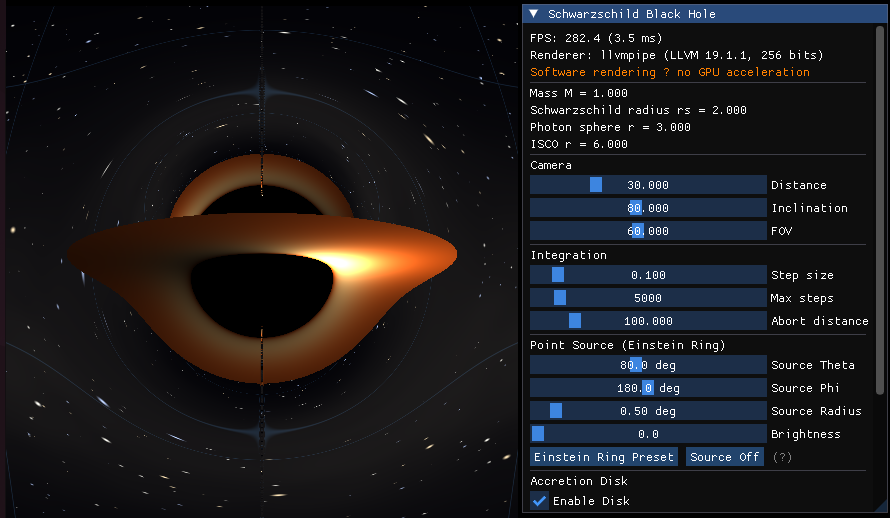
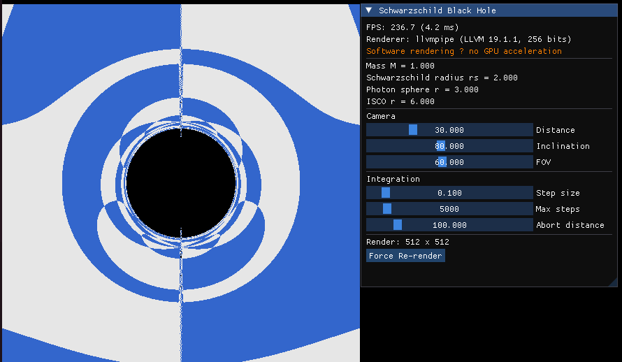
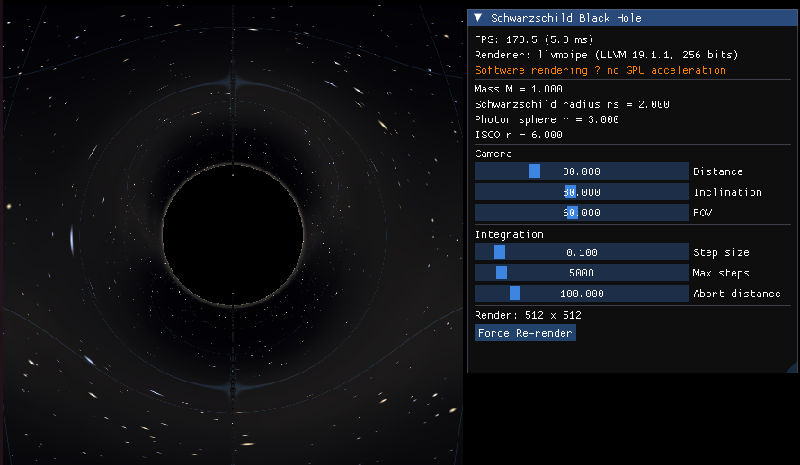
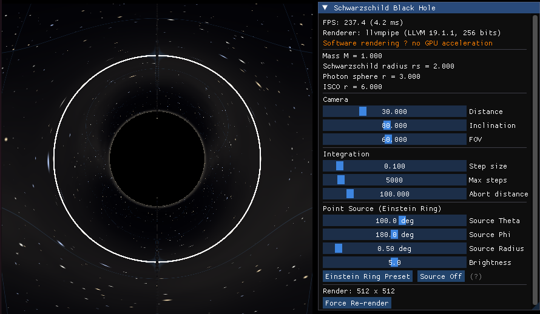

# Blackhole Renderer

Real-time Schwarzschild black hole ray tracer built with C++17 and OpenGL 4.3 Compute Shaders.

Light rays are traced **backwards** through curved spacetime by numerically integrating the null geodesic equations in the Hamiltonian formulation, producing physically accurate gravitational lensing, photon sphere shadows, Einstein rings, and accretion disk images.



---

## Features

### P0 — Core Infrastructure

| # | Feature | Description |
|---|---------|-------------|
| 1 | **Project Skeleton** | CMake build system, directory layout, imgui / nlohmann-json / spdlog integration |
| 2 | **Window & OpenGL Context** | GLFW window, OpenGL 4.3+ Core Profile, Compute Shader support |
| 3 | **Schwarzschild Metric** | `metric.h` — non-rotating black hole in Boyer-Lindquist coordinates (G = c = 1) |
| 4 | **Geodesic Integrator (CPU)** | RK4 integration of 8 coupled ODEs for null geodesics with adaptive step size |
| 5 | **Fullscreen Ray Marching** | `raytrace.comp` Compute Shader → RGBA32F texture → fullscreen quad |
| 6 | **Termination Conditions** | Captured (r ≤ r_s), Escaped (r > r_abort), Max-steps budget exhausted |



### P1 — Core Visual Effects

| # | Feature | Description |
|---|---------|-------------|
| 7 | **Gravitational Lensing** | Background starfield distorted by curved spacetime; procedural stars, Milky Way band, coordinate grid |
| 8 | **Photon Sphere Shadow** | Sharp shadow boundary at the critical impact parameter; photon ring glow from highly-wound orbits |
| 9 | **Einstein Ring** | Point light source behind the BH produces a complete ring image — key validation of integration accuracy |
| 10 | **Thin Accretion Disk** | Equatorial-plane geometrically thin disk with Novikov-Thorne temperature profile, gravitational redshift, and Doppler beaming |

| Gravitational Lensing | Photon Sphere Shadow |
|:-----:|:-----:|
|  |  |

| Einstein Ring | Accretion Disk |
|:-----:|:-----:|
|  |  |

---

## Physics

### Metric

Schwarzschild metric in Boyer-Lindquist coordinates (t, r, θ, φ):

$$ds^2 = -\left(1 - \frac{r_s}{r}\right)dt^2 + \frac{dr^2}{1 - r_s/r} + r^2\,d\theta^2 + r^2\sin^2\!\theta\,d\varphi^2$$

where r_s = 2GM/c² is the Schwarzschild radius.

### Geodesic Equations

Hamiltonian formulation with covariant momenta:

$$\frac{dx^\mu}{d\lambda} = g^{\mu\nu}\,p_\nu, \qquad \frac{dp_\mu}{d\lambda} = -\frac{1}{2}\,\frac{\partial g^{\alpha\beta}}{\partial x^\mu}\,p_\alpha\,p_\beta$$

Integrated with 4th-order Runge-Kutta and adaptive step size that shrinks near the horizon.

### Camera Model

Local orthonormal tetrad of a static observer at (r_obs, θ_obs):

$$\hat{e}_{(r)} = \sqrt{f}\;\partial_r, \quad \hat{e}_{(\theta)} = \frac{1}{r}\;\partial_\theta, \quad \hat{e}_{(\varphi)} = \frac{1}{r\sin\theta}\;\partial_\varphi$$

Each pixel maps to a direction in this frame, converted to covariant momenta for integration.

### Accretion Disk

- **Geometry**: geometrically thin, optically thick disk at θ = π/2
- **Temperature**: T(r) ∝ r⁻³/⁴ · [1 − √(r_in/r)]¹/⁴ (simplified Novikov-Thorne)
- **Colour**: blackbody palette — blue-white (ISCO) → orange-red (outer edge)
- **Redshift**: gravitational dimming by √(1 − r_s/r)
- **Doppler**: Keplerian orbital velocity with δ³ relativistic beaming

---

## Build

### Prerequisites

- C++17 compiler (GCC 9+ / Clang 10+)
- CMake ≥ 3.10
- OpenGL 4.3+ (or Mesa llvmpipe for software rendering)
- System packages: `libglfw3-dev`, `libglew-dev`, `libglm-dev`

### Compile

```bash
mkdir -p build && cd build
cmake ..
make -j$(nproc)
```

The executable is placed in `bin/BlackholeRenderer`.

### Run

```bash
./bin/BlackholeRenderer
```

Configuration is loaded from `etc/config.json`.

#### GPU rendering

The renderer needs an OpenGL 4.3+ **Core Profile** context with compute-shader
support. On a normal Linux desktop with the vendor driver installed, the GPU is
selected automatically — no extra configuration is required:

```bash
# Native Linux (NVIDIA proprietary / AMD / Intel Mesa)
./bin/BlackholeRenderer
```

On **WSL2**, OpenGL is provided by Mesa's `d3d12` Gallium driver through the
Windows GPU passthrough (`/dev/dxg`). The default driver selection, however,
falls back to the CPU `llvmpipe`, so you must select the D3D12 driver
explicitly:

```bash
# WSL2 (Windows 11 + WSLg)
GALLIUM_DRIVER=d3d12 ./bin/BlackholeRenderer
```

Check the renderer string in the startup log or the ImGui panel: it should read
`D3D12 (NVIDIA GeForce RTX ...)`. If it reads `llvmpipe` you are on the software
fallback (a warning is logged).

WSL2 GPU requirements: Windows 11 with WSLg, the vendor WSL driver installed on
the Windows side, and `libgl1-mesa-dri` in the distro (provides
`d3d12_dri.so`).

Measured on an RTX 4070 at 512×512 with 5000 max steps: **~10 ms/frame
(~100 FPS)** via D3D12 versus **~550 ms/frame (~2 FPS)** on llvmpipe.

---

## Configuration

Edit `etc/config.json` to adjust parameters:

```json
{
    "blackhole": {
        "mass": 1.0,
        "rs": 2.0
    },
    "camera": {
        "distance": 30.0,
        "inclination": 80.0,
        "fov": 60.0
    },
    "accretion_disk": {
        "inner_radius": 6.0,
        "outer_radius": 12.0,
        "temperature": 1.0
    },
    "rendering": {
        "width": 512,
        "height": 512,
        "max_steps": 5000,
        "step_size": 0.1,
        "abort_distance": 100.0,
        "exposure": 1.0,
        "gamma": 1.0
    }
}
```

All parameters can also be adjusted at runtime through the ImGui control panel.

---

## Project Structure

```
blackhole-renderer/
├── CMakeLists.txt
├── etc/
│   └── config.json              # Runtime configuration
├── shaders/
│   ├── raytrace.comp            # Compute shader — geodesic integration
│   ├── fullscreen.vert          # Fullscreen quad vertex shader
│   └── render.frag              # Texture sampling fragment shader
├── include/
│   ├── core/
│   │   ├── metric.h             # Schwarzschild metric
│   │   └── geodesic_integrator.h# CPU RK4 integrator
│   ├── rendering/
│   │   ├── ray_tracer.h         # GPU ray tracer (compute dispatch)
│   │   └── accretion_disk.h     # Thin disk model documentation
│   ├── app/
│   │   ├── config.h             # JSON config parser
│   │   └── window.h             # GLFW window wrapper
│   └── logging/
│       ├── logger.h             # ILogger interface + macros
│       └── spdlog_logger.h      # spdlog backend
├── src/
│   ├── main.cpp                 # Entry point, ImGui panel, main loop
│   ├── core/
│   │   ├── metric.cpp
│   │   └── geodesic_integrator.cpp
│   ├── rendering/
│   │   └── ray_tracer.cpp
│   ├── app/
│   │   ├── config.cpp
│   │   └── window.cpp
│   └── logging/
│       └── spdlog_logger.cpp
├── lib/                         # Third-party (vendored)
│   ├── imgui/
│   ├── nlohmann/
│   └── spdlog/
└── fig/                         # Screenshots
```

---

## Interactive Controls

The ImGui panel provides real-time adjustment of:

- **Camera**: distance, inclination, field of view
- **Integration**: step size, max steps, abort distance
- **Einstein Ring**: point source position (θ, φ), angular radius, brightness
- **Accretion Disk**: enable/disable, inner/outer radius, temperature

Changes trigger an immediate re-render via the compute shader.

---

## Key Physical Radii

For M = 1 (r_s = 2):

| Radius | Value | Significance |
|--------|-------|--------------|
| Event Horizon | r = 2.0 | Point of no return |
| Photon Sphere | r = 3.0 | Unstable circular photon orbits |
| ISCO | r = 6.0 | Innermost stable circular orbit |

---